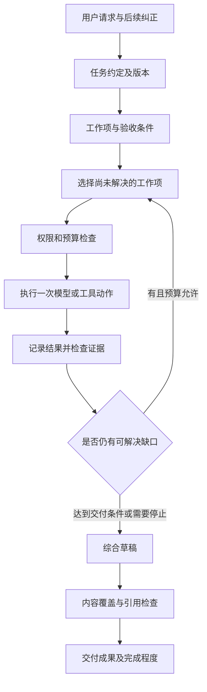

# 灯灯任务完成可靠性研究

日期：2026-10-21。基线为原工作副本 `437fb6f`；隔离工作树中的等价补丁为 `5ab8ff0`。本文是调查与设计建议，不表示下述改造已经实现。

## 结论与研究边界

主要缺口在自定义 Harness 的任务状态与质量验收：系统以工具种类表达计划，以工具返回成功推进状态，以已检索 URL 白名单约束引用；这些信息不足以判断用户的多个目标是否完成。意图识别已能表达目标和来源，但没有贯穿计划、证据和验收的结构化任务约定。

当前具备工具权限、参数校验、超时、幂等账本、检查点、模型版本绑定等基础。建议在这些边界内演进任务与证据模型，先用评测证明收益，再决定是否增加模型调用或引入其他框架。

依据包括真实失败记录、源码、无网络的合成复现及官方工程资料。没有重新搜索招聘信息，没有额外调用真实模型，也没有改写聊天历史。本文评估执行系统，不核验原回答中的招聘数字。

## 1. 真实轨迹说明了什么

样本请求为整理近期社招情况与公开讨论。该次运行 321,375 毫秒，11 次搜索返回 61 条来源，其中 49 条缺少 `published_at` 元数据。缺少元数据不等于正文中也没有日期，但程序没有完成结构化的日期核验。

| 环节 | 记录值 | 判断 |
| --- | --- | --- |
| 分类与规划 | 9.507 + 28.838 秒 | 尚未执行搜索就使用约 38 秒；增加更多固定模型阶段前必须测量开销 |
| 搜索 | 11 次，共 89.671 秒 | 调用成功，不代表材料满足研究要求 |
| 执行模型 | 4 次，共 72.493 秒 | 输入从 2,858 增至 36,842、67,152、98,689 token |
| 引用修正 | 60.034 + 60.706 秒 | 正文之后的格式修正发生两次超时 |
| 计划 | 1 步，4 条成功条件 | 有输出要求，但程序没有逐项检查其结果 |

三次讨论查询分别返回 8、5、5 条结果。第一批主要为美股视频、原油等材料；另一批含越南招聘和校招；最后一批含 App Store、媒体报道及一条低相关脉脉页面。证据不足并不意味着相关社区讨论不存在。

正文中的中国日报子链接来自检索页面内嵌链接，但该子页面没有成为本轮来源。引用器按白名单拒绝它符合现有契约；修正应优先引用已经读取、能够支持句子的父页面，或在权限与预算允许时另外读取子页面，不能自动将页面内所有外链认定为证据。

已有本地补丁限制研究上下文和引用修正预算；此前真实草稿的修正回放约 7.5 秒完成。那次验证只覆盖引用阶段，不能用于推断完整研究任务已变快或质量已达标。

## 2. 源码与合成实验的交叉验证

实验使用固定材料与模拟模型，不请求网络、不调用真实模型、不写入业务数据库。下面记录的是当前行为，不能作为未来应该保持的测试预期。

| 编号 | 输入或实验 | 当前观测 | 源码与含义 |
| --- | --- | --- | --- |
| E1 | 规划器返回“查事实”“查讨论”，两步均使用公开搜索 | 解析后剩 1 步 | [`parse_plan`](../backend/app/agent/orchestration.py#L318) 按工具名去重；不同工作目的被合并 |
| E2 | 绕过解析，直接把两个同工具步骤交给计划校验 | 校验后仍剩 1 步 | [`validate_plan`](../backend/app/agent/plan_validator.py#L25) 再次去重；只修提示词或解析器不够 |
| E3 | 成功条件要求事实与讨论，只有一次搜索成功事件 | `complete=true` | [`validate_completion`](../backend/app/agent/completion.py#L37) 检查必需能力是否调用成功，没有检查内容覆盖 |
| E4 | 两条无依据结论，仅带一个白名单链接 | 引用校验通过 | [`validate_web_citations`](../backend/app/agent/runtime.py#L115) 约束 URL 身份，没有逐结论覆盖和支持关系；这是其职责范围，不应被当成事实核验 |
| E5 | 假搜索服务仅返回无关的美股材料，分数 0.01 | 工具 `done`，提示“可基于来源回答” | [`SearchPublicWebTool`](../backend/app/tools/search_public_web.py#L171) 检查非空资料与片段，未判断任务相关性 |
| E6 | 模拟模型根据 E5 声称“招聘增长、公众乐观”，引用该已知 URL | 完整 runtime 返回 `done`，计划步骤也是 `done` | 证明工具成功、引用合规与用户目标达成之间存在端到端缺口 |
| E7 | 来源日期字段为字符串 `unknown` | `freshness_known=true` | [`build_evidence_bundle`](../backend/app/research/web.py#L78) 使用字符串非空判断；这是合成边界风险，不能断言真实样本里出现过同一字符串 |
| E8 | 显式说“联网搜索近期社招情况与公众讨论” | 规则路由跳过分类，直接为静态计划 | 任务复杂度与路由词耦合；语义相近的“帮我搜一下，整理……”会进入分类，有机会取得综合研究标记 |

真实轨迹仅保存了规范化后的计划，不能据此还原模型在规范化前是否曾输出多个步骤。能够确定的是：当前两处代码会合并同工具工作项，E1/E2 已复现；不能确定这次实际运行究竟在哪一处首次丢掉工作项。

### 2.1 意图识别：路由信息还不是完整任务约定

[`TaskUnderstanding`](../backend/app/agent/orchestration.py#L142) 只有 `kind`、`goal`、`sources`、`needs_planning`。它解决类型和来源选择，但时间范围、地域、排除项、多个交付物及假设仍依赖自然语言目标和历史消息。当前也没有为任务目标建立独立版本。

分类器是条件调用，明确路由的请求可能走规则快速路径。E8 确认同一多目标研究的表达方式会改变理解和规划路径：规则路径没有识别综合研究标记，单工具类别又被判为静态计划。因此，系统质量不能依赖“每次一定运行过完整意图识别”，任务复杂度应独立于工具路由判断。简单问答也不应被迫增加规划模型调用。

### 2.2 计划与状态：工作项被等同于工具

[`AgentPlanStep`](../backend/app/domain/agent.py#L101) 强制绑定一个 `tool_name`，没有依赖、交付物关联和证据要求。runtime 按工具名选取第一个匹配步骤，工具返回 `done` 就更新该步骤为 `done`。即使删除去重逻辑，原有状态关联仍无法正确区分多个搜索目的。

必须一起修改解析、校验、调用归属、状态推进、完成检查和恢复；仅允许显示多个步骤会产生看似丰富但仍不可信的进度。

### 2.3 搜索与证据：约束还停留在查询词中

[`SearchRequest`](../backend/app/research/options.py#L18) 只有查询、数量、类别、来源偏好与任务类别。生产工具无法显式表达本次研究的起止日期或目标平台域名；Tavily 适配器当前只为技术偏好传固定域名列表，且为 `prefer`。

查询里写 `site:zhihu.com OR site:weibo.com`，不等于服务已经接受和实施了对应过滤；真实记录返回其他域名，应用仍照常接收。不能仅凭这一点断言服务的解析器存在故障，原因还需要实际请求参数与服务行为对照。

证据构造存在等级、分数、日期字段和排序，但排序不等于相关性验收。官方材料也可能与当前主题无关；宏观就业和校园招聘不能因来源权威就支撑社招结论。不同域名的转载也不自动构成独立证据。

### 2.4 执行控制：技术失败与研究缺口未分离

目前主要防护是最大轮次、单次超时、有限重试和完全相同调用指纹去重。改变措辞重复搜索同一缺口，仍然可以消耗轮次；同一响应中的多个搜索按顺序执行，轮次也不等于调用次数或总耗时。

没有相关材料是研究状态，HTTP 超时是技术状态，两者需要不同的后续策略。前者应调整来源或说明缺口，后者应按风险和预算决定重试。

### 2.5 评测与呈现：基础契约通过不等于研究质量通过

现有 [`eval_harness`](../backend/app/agent/eval_harness.py#L36) 和 pytest 覆盖路由、解析、权限、工具循环、引用等，价值明确。但分类和计划用例注入模拟的 `model_output`，不是当前真实模型的任务理解能力测量；引用用例主要验证 URL 身份。

另有一个入口差异：pytest 自动加载所有 cases 文件，Promptfoo 配置显式列出三个文件，没有包含 `task_sources.json`。因此不能说这组用例完全没运行，也不能认为所有评测入口覆盖相同。

[`AgentRunResult`](../backend/app/domain/agent.py#L173) 与前端只有 `done / failed / waiting_user / cancelled` 等执行状态。文本任务的失败在过程栏主要呈现为“生成失败”，难以区分正文已有但引用未核验、研究材料不足与模型完全未响应。

## 3. 外部资料与本项目的对应关系

- Anthropic 将路由、工作流、动态工具循环区分为不同模式，并建议以可组合的简单组件起步。对灯灯的启示是先修复目标、状态和验收边界，再用评测决定是否增加阶段；不能据此推断换用某个框架就会改善这次任务。[Building effective agents](https://www.anthropic.com/research/building-effective-agents)
- 其研究型 Agent 评测建议结合结论支持、覆盖和来源质量，并用人工判断校准模型评分。灯灯需要补充这类产品评测；单纯 URL 通过率和工具成功率无法替代它们。[Demystifying evals for AI agents](https://www.anthropic.com/research/demystifying-evals-for-ai-agents)
- 持久会话日志与模型当前上下文可以分离，压缩后的内容应仍能从原记录恢复。这与灯灯保留原始事件、投影模型上下文的方向一致；下一步可按当前工作项读取相关证据，而非只按新旧顺序保留。[Scaling Managed Agents](https://www.anthropic.com/research/managed-agents)
- Tavily 当前文档提供域名限制模式和日期参数；日期可能是发布或更新时间的估计，日期窗口也可能保留未知日期结果，除非启用对应过滤。应用仍需检查返回结果，且必须区分发布日期和统计覆盖期。[Tavily Search API](https://docs.tavily.com/documentation/api-reference/endpoint/search)

以上是架构与接口依据，不是对灯灯改造效果的实测证明。新增 API 参数应先通过适配器能力与模拟契约测试验证，不能直接假定所有搜索后端都支持。

## 4. 建议的数据与执行边界

### 4.1 结构化任务约定

新增一个与任务类型、权限路由分离的任务对象，保留 `objective`、多个 `deliverables`、范围、排除项、假设和版本。

每个范围字段标明来自用户明确说明、上下文还是系统假设。后续纠正只更新相关字段，并使受影响的计划和证据验收失效；未受影响的成果可以复用。关键歧义才询问，普通可逆选择采用明确展示的假设。

联网授权、私人资料外发批准和写入批准仍由服务端策略决定；模型生成的任务对象不能扩大这些权限。保留当前模型绑定和外发审批恢复规则。

用户明确选择的搜索类别与来源偏好也继续生效。新增日期、域名等工作项约束需经适配器能力检查，与冻结的本轮选项协调；不支持或冲突时显式记录，不能默默覆盖用户设置。

### 4.2 工作项与工具调用分开

工作项建议包含：稳定 ID、目标交付物 ID、依赖、允许工具子集、证据要求、状态、尝试记录和结束理由。同一个工具可以服务不同工作项。

先采用一次只有一个活动工作项的顺序执行模型，工具调用由 Harness 标记归属，不能按工具名猜测。这样可以先保证关联、恢复和验收正确，再评估独立查询并发的收益。

工具 `done` 只代表一次操作完成；工作项只有满足条件或明确记录证据不足时才能结束。合成、比较、交付等工作项不应被迫伪装成外部工具。

### 4.3 可追溯证据池

来源记录 URL、标题、提取状态、日期值与日期依据；片段记录来源 ID、原文位置、读取时间和内容指纹；相关性判断绑定工作项与任务版本。

材料角色至少区分直接支持、反对、背景和无关。日期需要区分发表时间、更新时间、事件时间和统计覆盖期。缺失日期可以保留为未知材料，但不能自动支撑指定时段的结论。

检索无命中应明确到工作项和查询策略；不能推导为整个资料库或互联网都没有相关信息。来源分数用于排序参考，不能跨服务套一个固定阈值，也不能替代语义判断。

### 4.4 以缺口驱动执行

每次搜索记录工作项、待填缺口、查询策略、实际服务参数和新增有效证据。连续低收益时改变一个可解释的维度，例如平台、时间表达或查询宽度；达到预算后交付缺口，而不是无限重试。

总预算同时覆盖运行时间、模型和工具调用数、上下文与输出，而不只限制循环轮次。保留现有引用修正的独立时限；恢复任务时保留已花费预算，不能靠重连重置上限。

### 4.5 分开执行状态和成果质量

先保留现有执行状态协议，增加独立的成果字段，例如 `fulfillment: complete / partial / insufficient` 和 `verification: passed / warnings / unverified`，避免立即扩张所有前后端状态枚举。

确定性检查负责身份、权限、必需工作项覆盖、引用存在和支持片段记录。模型检查用于主题相关性、结论与片段的支持关系、综合遗漏及冲突。模型检查输出也需要 schema 校验、预算和失败降级；同一模型的自评不能视为独立事实真值。

引用器保留当前职责。内容核验可以指出缺乏支持、要求补证或删弱结论；引用格式修正只能改链接或追加引用，不能负责修复研究质量。核验未完成时保留草稿并说明状态。

## 5. 渐进落地与验收

| 阶段 | 修改范围 | 可检查的交付 |
| --- | --- | --- |
| A：任务与工作项 | domain、分类/规划、解析/校验、runtime 调用归属、快照、前端计划类型 | 同工具多目标不丢失；工具成功不自动完成工作项；用户纠正后版本与受影响状态正确更新 |
| B：证据与搜索适配 | SearchRequest、Tavily/AgentSearch、证据池、执行缺口与预算 | 无关材料不计入目标证据；日期/域名约束可追踪实际执行；没有新增有效证据时会调整或收敛 |
| C：成果验收与呈现 | completion、结果质量字段、聊天历史/摘要、AG-UI 和过程展示 | 能区分部分完成、技术失败与未核验；未满足的必需目标不能被无条件标为完成 |
| D：模型与耗时调优 | 阶段调用策略、上下文选取、必要的并发 | 在同一评测集下比较覆盖、支持程度、耗时和用量，再决定新增调用是否值得 |

实现阶段 A 时必须覆盖解析器与校验器两处去重、按工具名匹配步骤的 runtime、工具状态到步骤状态的映射，以及恢复和前端展示。必须保留 required-capability 安全检查，但将其视为执行前置义务，而非完整的业务验收。

旧快照缺少新字段时，映射为传统工作项，质量标记为未评估；不能假造历史证据。当前账本已有 `step_id`，可评估在版本化快照中先保存新增字段，避免为研究方案预先执行数据库迁移。读取私有资料、外发和写入的授权不能因兼容处理而放宽。

## 6. 如何证明改造有效

增加跨领域的固定轨迹用例，避免只对“社招”关键词打补丁：

| 场景 | 应验收的行为 |
| --- | --- |
| 两项目标使用同一工具 | 两个稳定工作项分别保留、归属和验收 |
| 研究只找到其中一个维度 | 交付已有成果并明确另一维度不足，不能宣称全部完成 |
| 只返回无关视频或 App 页面 | 搜索操作可成功，目标证据状态应为不足 |
| 官方来源讨论相邻概念 | 不因域名权威就算满足主题 |
| 发布日期新、统计期旧 | 不当作当前时段数据 |
| 无日期、日期冲突或正文提取失败 | 分别保留状态，不能用非空字符串代替核验 |
| 有效链接支撑不了结论 | 链接身份可通过，成果核验应指出缺乏支持 |
| 用户纠正范围或排除私人资料 | 更新任务版本和受影响工作项，保留权限边界 |
| 仅换措辞重复无效搜索 | 按证据增益收敛，正确消耗总预算 |
| 模型超时、核验失败、断线恢复 | 保留草稿和已完成成果，不重复副作用或重置预算 |
| 简单事实、文本改写或日常问答 | 不强制增加整套多阶段研究流程 |
| 外部材料含伪指令 | 保持作为数据，不得改变任务和授权 |

固定材料的端到端模拟用于 CI 的状态与策略契约；另用可控数量的真实模型试验测量任务理解和实际决策。现有模拟评测应保留并准确命名，避免与真实模型质量混淆。

比较至少包括目标覆盖、结论支持、来源适用性、纠正后的适应、重复无效调用数、首个有用反馈与总耗时、输入/输出用量、错误终态率。开放研究的语义评分需要人工校准，不预先编造通过率或性能收益。

采用相同冻结材料，对照旧/新 Harness；再在相同 Harness 下对照模型，避免把模型、搜索服务和框架改动同时混在一起。每个任务允许不同合理执行路径，不要求逐条复制某次查询顺序。真实模型应有重复试验，报告波动及预算。

## 7. 仍未得到证明的部分

- 未进行模型间受控对照，不能量化 Grok 模型本身对质量问题的贡献。
- 未重新查询实际平台，不能断言当前搜索服务不可用、相关原帖不存在或更换服务一定有效。
- 没有原始规划输出的逐阶段回放，不能确定真实单步计划首次形成的确切位置。
- 日期和域名参数已经在官方文档确认，但还需要与本项目适配器及实际服务版本做契约验证。
- 8 张修正卡、固定字符预算和低推理修正解决的是此前具体运行风险；对证据选择质量仍需评测。不能把单次成功回放当作整体可靠性结论。

本次研究交付为这份设计与可复现观察，未改变任务执行行为。优先实现阶段 A 的纵向闭环，再以相同轨迹验证阶段 B/C 的收益。
