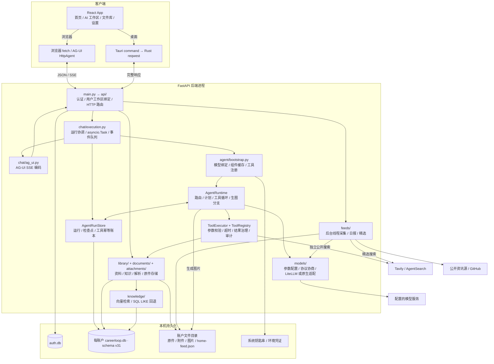
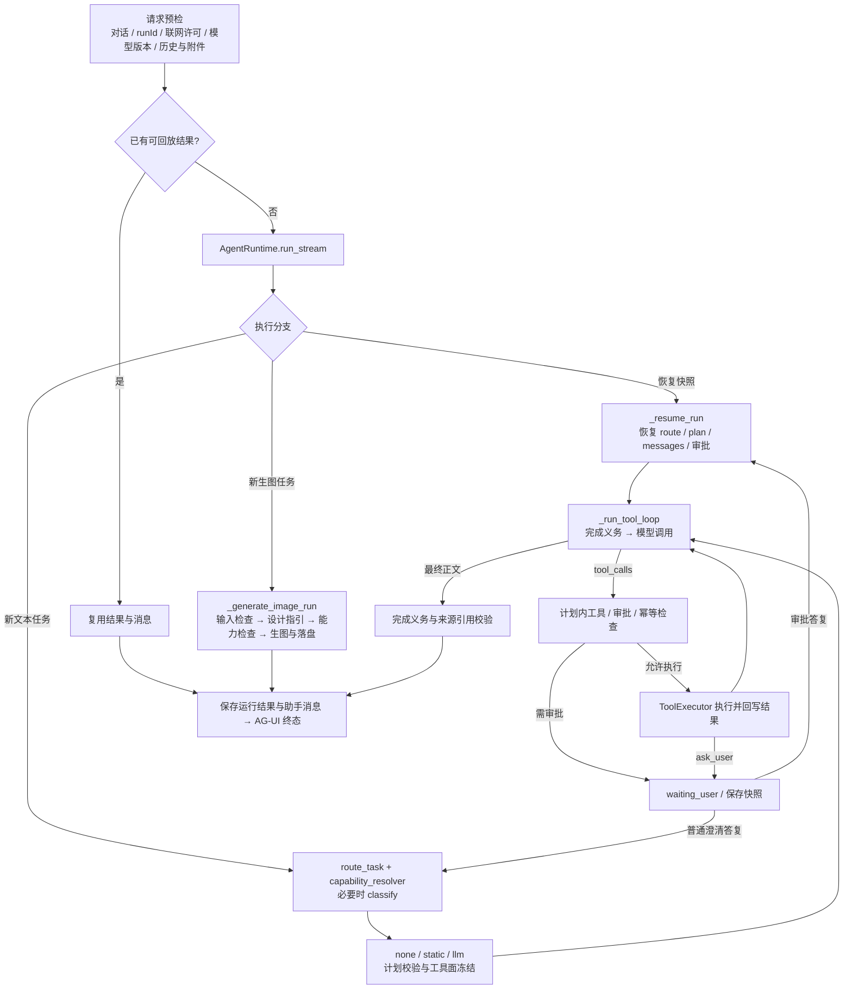

# 灯灯智能体

维护基线：2026-10-20，按当前源码校准。代码决定实际行为；本文记录模块关系、执行约束和修改入口。历史变更查 Git，界面细节与接入说明见文末专题链接。

## 架构总览

灯灯是本地优先的个人 AI 协作工作台。浏览器与 Tauri 桌面端复用 React 前端和 FastAPI 后端；一个 `AgentRuntime` 实现文本任务与生图分支，首页资讯独立执行。



图示为主要调用与数据关系，省略配置、消息和监控各自的数据库读写。附件另支持可选 MinIO。

| 边界 | 实际实现 |
| --- | --- |
| 前端状态 | `App.tsx` 组合 `useChatRun`、`useConversations`、`useLibrary`；聊天订阅使用 `@ag-ui/client` |
| 账户隔离 | `main.py` 校验登录会话后绑定 `workspace.py`；业务库位于 `workspaces/<user_id>/careerloop.db`，认证使用独立 `auth.db` |
| 桌面壳 | Rust 启动 loopback sidecar、分配动态端口并核验 `/health`；Agent 留在 Python。`text/event-stream` 经 `desktop-api-stream` 按块推到 WebView，其它响应仍整包返回；事件丢失时回退为完整正文 |
| 任务调度 | 聊天为进程内 `asyncio.Task`，首页为工作区绑定线程；SQLite 保存状态与恢复依据，不承担独立 worker 调度。退出应用即停止任务，不会在关机后继续生成 |
| Sites 副本 | 工作区另有独立前端仓库，检出在 `sites/`，不纳入本仓库，也不与 `frontend/` 同步；经本机 `8001 → 8000` 转发访问后端，不属于此仓库的 Agent 执行层 |

`main.py` 的公开静态资源白名单包含当前灯灯图标、品牌标志、favicon 和产品介绍背景；浏览器图片请求无需会话即可读取这些固定路径，业务接口和未列出的文件仍需认证。`/assets/` 的哈希构建资源可长期缓存，根目录品牌图片不使用 immutable 缓存。

CD 可通过 `CAREERLOOP_MAINTENANCE_FILE` 指定维护标记：标记存在时除 `/health` 外均返回禁止缓存的 503 和 `Retry-After`，候选版本尚未验证前不接收用户写入。部署管理器先停服备份，再切换代码并校验认证库及全部工作区；未完成事务恢复后才放行流量。具体边界与首次启用见[持续部署](continuous-deployment.md)。

## 对话运行时

入口：[`api/chat.py`](../backend/app/api/chat.py) 的 `POST /ag-ui` → [`chat/execution.py`](../backend/app/chat/execution.py)。运行状态集中在 `RunContext`；新任务与恢复任务共用 `_run_tool_loop`。



`runtime.run_stream` 与 `chat/execution.py` 各有事件队列，`chat/ag_ui.py` 负责最终编码；业务模块不依赖 `main.py` 的可变状态。

已初始化的钥匙串连接在配置、模型列表、能力和监控展示时仅校验工作区引用，返回 `credential_status=saved_unverified`，不读取 API Key 或构造模型提供者；前端不为该状态静默读取服务商模型目录。实际对话、显式检测、目录读取和保存仍按原流程读取 / 校验凭证；预览不能用于恢复运行或绕过凭证指纹校验。首次旧配置迁移仍可能访问钥匙串，详见 [模型层](model-layer.md)。

## 路由与计划

源码：[`orchestration.py`](../backend/app/agent/orchestration.py)、[`capability_resolver.py`](../backend/app/agent/capability_resolver.py)、[`plan_builder.py`](../backend/app/agent/plan_builder.py)、[`plan_validator.py`](../backend/app/agent/plan_validator.py)。

| kind | 基线能力 | 完成义务 |
| --- | --- | --- |
| `conversation` | 无；可由文本信号扩展 | 按显式能力请求决定 |
| `library_search` | `library.read`、`library.search` | 本地资料读取组成功 |
| `content_creation` | 无；按所需来源扩展 | 按私人资料 / 公开来源请求决定 |
| `library_update` | `library.read`、`library.propose` | 生成待确认知识 |
| `web_search` | `web.search.generic`，需联网许可 | 公开搜索成功 |

规则路由保留明确资料操作和公开查询的快速路径。开放任务、来源未明确的创作、带否定约束的请求以及普通澄清回复调用分类模型，分别返回 `kind`、`goal`、`sources`（`private_library` / `public_web`，可为空）与 `needs_planning`。分析时带入有限的最近用户请求，帮助还原“继续”等短回复；不把历史助手的推测用于来源判断。完整目标传给规划器，当前 UTC 日期传给分类、规划与计划执行上下文。任务类型不决定私人资料来源；整理、写作不再默认读取简历或笔记。旧版仅返回 kind 的分类响应仍可解析。

来源需求由当前请求与澄清上下文判断，再与已注册工具、联网开关交集解析；模型不能自行开启联网或添加工具。明确要求私人资料或公开研究时，对应读取 / 搜索成为完成义务。来源不明可用 `ask_user` 澄清，不把缺少私人资料误报为无法整理公开情况。

| 计划模式 | 条件 | 行为 |
| --- | --- | --- |
| `none` | 无路由工具 | 不调用规划模型，仍可用中断工具 `ask_user` |
| `static` | 单一能力组且不需综合研究 | 使用确定性计划 |
| `llm` | 多能力组或 `needs_planning=true` | 调用规划模型；解析失败可用兜底计划，规划调用失败则终止 |

计划必须满足 `required ⊆ planned ⊆ allowed ⊆ registered`；非法计划返回 `plan_validation_failed`。同组资料读取工具可互相满足完成义务，计划替代工具会被冻结。`ask_user` 始终作为中断工具暴露，不加入车道计划。

研究计划可包含 `expected_output` 与 `success_criteria`，前者展示为交付目标；执行提示要求对照交付目标、证据缺口、来源与时间范围作答。这是模型侧检查指引，尚不构成独立的事实正确性评审。计划仍按工具去重，一个工具可在执行循环中发起多次不同查询。

## 工具目录

注册以 [`bootstrap._build_tool_registry`](../backend/app/agent/bootstrap.py) 为准；策略以 [`tooling/specs.py`](../backend/app/tooling/specs.py) 为准，`TOOL_POLICIES` 是其兼容别名。

| 已注册工具 | 风险 | 数据与行为 |
| --- | --- | --- |
| `ask_user` | `read_only` | 返回澄清选项并暂停 |
| `search_public_web` | `external_read` | Tavily / AgentSearch；受联网许可、配置和外发审批约束 |
| `get_library_context` | `read_only` | 读取已启用资料与已确认知识，尊重记忆开关和隐私模式 |
| `search_library` | `read_only` | 过滤明显无关的近邻，返回资料来源数、片段数与 `evidence_status` |
| `propose_library_knowledge` | `local_pending_write` | 只创建 pending 知识，用户审核后才能成为 confirmed |

[`ToolExecutor`](../backend/app/agent/tool_executor.py) 依次执行中央参数校验、handler 超时控制、结果大小治理与审计；模型可见工具还受当前计划限制。`image_generation`、`agent_thinking`、`agent_planner`、`model_provider`、校验器与循环防护均是活动事件，不是新增注册工具。

本地检索工具启用 `search_knowledge(relevant_only=True)`：哈希嵌入要求有非通用检索词的文本重合，语义嵌入按单位向量 L2 距离换算的余弦相似度 ≥0.3 筛选；SQL LIKE 回退保留精确匹配。此门槛用于去除明显无关项，不能保证语义相关性或检索完备性。其他检索调用保持原排序兼容。无结果返回 `evidence_status=empty` 并提示调整查询或使用其他已授权来源，不将“检索成功”解释为“有足够证据”，也不据此断言整个库没有相关内容。

## 审批、重试与收敛

| 情况 | 执行约束 |
| --- | --- |
| 混合任务外发 | `EgressPolicy` 对本地资料 + 公开搜索任务逐条展示查询，未批准不请求搜索、不写工具账本；搜索工具出网前再次复核。重新规划只保留公开工具时，若澄清上下文来自此前私人资料读取，仍保留该边界 |
| 外发回复 | 批准仅覆盖规范化后的查询；自定义回复替换查询；拒绝移除联网能力。纯公开搜索使用本轮联网许可，不逐条审批 |
| 待确认写入 | `confirmed_local_write` 调用按工具名与参数指纹审批；批准后执行，拒绝移除工具。当前五工具没有此风险，接缝由测试覆盖 |
| 模型与安全工具重试 | 默认各 1 次；工具仅在只读、派生分析、外部读取风险且错误明确 retryable 时重试，本地写入不自动重试 |
| 参数自愈 | `invalid_arguments` 字段摘要回传模型，每次循环最多修正重试 2 次，优先于重规划 |
| 同车道重规划 | 有计划且 `needs_plan` 时至多一次，不能扩权；blocked、超时、执行异常不走此路径 |
| 重复成功调用 | 同名同参数第一次重复跳过并要求推进，再次重复返回 `tool_loop_detected` |
| 完成与引用 | 必需能力未完成先纠正，同一缺失集合再次出现则失败；用过联网工具后，Markdown 链接须来自本轮来源，支持中文 / UTF-8 编码和带括号的网址，但不放宽业务查询参数或域名匹配 |
| 引用修正 | [`citations.py`](../backend/app/agent/citations.py) 只接受结构化 `replace_url` / `cite_after` 补丁。来源 ID 必须来自本轮证据卡，支持引文须为对应片段中至少 12 字的连续原文；程序只修改 URL 或追加引用，禁止改写正文、改变任务或再次调用工具 |
| 修正失败 | 无效补丁、偏题正文、模型异常或二次引用失败均保留首次回答草稿并标记未完成校验，不使用失败的修正覆盖草稿。补丁缓冲处理，不向聊天流输出 JSON 或格式修正推理 |
| 轮次耗尽 | 默认最多 8 个执行轮次；可额外进行一次无工具的引用修正。普通耗尽以 `round_limit_reached` 失败，保留本次运行最后一条非空助手正文并附终止说明，不回捞历史回答 |

默认单次工具超时 60 秒；可配置项见 [`config.py`](../backend/app/config.py)。[`tools/limits.py`](../backend/app/tools/limits.py) 统一限制结果：message/错误 ≤4000 字符、data 单串 ≤3000、列表/键 ≤50、深度 ≤6、完整 data JSON ≤32000 字符；URL 完整保留或省略，截断标记为 `truncated: true`。治理后的结果用于上下文、快照、账本与事件。

公开检索在中央治理前先压缩重复正文：来源摘要 / 正文各至多 400 字，证据优先保留 800–1600 字，超预算时先缩短证据再减少尾部来源，网址不截断。证据同时优先纳入搜索摘要，避免网页前部导航挤掉查询相关片段。

多轮执行通过 [`research_context.py`](../backend/app/agent/research_context.py) 投影模型可见的公开搜索结果：同一 URL 全程仅保留一份证据，搜索 payload 合计以 48,000 字符为预算；先保留来源身份，再优先为较新结果分配至多 1,200 字的片段。预算不足的片段明确标为省略，不得视为已核验。工具调用 / 响应配对、其他消息与模型签名不变；原始结果继续保存在事件和检查点，引用白名单不随投影缩小。

引用修正使用当前任务、原草稿与独立证据卡：有未知网址时按对应句子的文本重合度选取至多 8 张候选卡，只修复未知网址；无引用时至多 16 张。每卡可见片段至多 1,000 字，数据上下文预算 24,000 字符，超预算先移除尾部卡；草稿本身超预算时停止修正并保留原文。修正显式使用低推理强度、最多 3,000 输出 token、30 秒整体时限，不进入 runtime 的模型自动重试，超时会取消请求并保留草稿。支持的推理参数由模型层按协议转换，服务商是否遵从仍取决于其能力。此校验只约束引用身份与补丁范围，不等于事实支持关系已经得到独立审查。

## 持久化运行状态

实现：[`run_store.py`](../backend/app/agent/run_store.py)、[`snapshots.py`](../backend/app/agent/snapshots.py)、[`resume_policy.py`](../backend/app/agent/resume_policy.py)。

| 场景 / 存储 | 语义 |
| --- | --- |
| `agent_execution_runs` | `runId` 只属于一个对话；保存输入、冻结模型绑定、联网选项、检查点与终态结果 |
| `agent_run_steps` / `agent_tool_executions` | 保存计划步骤和按 runId + 调用指纹去重的工具结果；done 可回放，中断的安全读取可重做，结果不明的本地写入禁止重放 |
| 同一 runId 重连 | 复用原输入、选项和模型版本；中断任务从检查点继续，已完成任务重放结果，不重复追加原用户消息 |
| 引用修正恢复 | `citation_draft` / `citation_sources` / `citation_allowed_urls` 随检查点保存，完整来源白名单独立于修正候选卡；旧快照默认空值并回退到卡片 URL。修正恢复保持无工具状态，不重新搜索或丢失首次草稿 |
| 等待用户后继续 | `agent_run_snapshots` 保存计划、消息、完成证据与审批状态；下一确认轮使用新 runId，通过 `parent_run_id` / `resumed_by_run_id` 关联。`requires_query_approval` 默认 false，兼容旧快照并跨恢复保留外发边界 |
| 普通澄清回复 | 点选选项或自定义答复均重新分析来源与计划；带入最近四条用户任务与澄清问题，最新回复优先。不沿用旧的工具限制、工具原文和轮次预算；需要本地资料时可重新读取 |
| 改口与待批回复 | 明确放弃 / 换题会清快照；待批搜索 / 写入先处理审批回复。断线检查点恢复仍使用原计划，不重复分类与规划 |
| 启动 / 取消 | 启动将遗留 queued/running 标为 interrupted；取消同时写持久标记与取消进程内任务，调用等待期间每 250ms 检查标记 |
| 并发 / 查询 | 同一账户同一对话已有执行任务时返回 409；`GET /agent/runs/current` 返回安全摘要，不暴露原始检查点、参数或工具结果 |
| 对话整理 | `DELETE /chat/messages/{id}/tail` 删除该用户消息及之后的全部消息，响应包含被删消息和原标题。客户端可用 `POST /chat/messages/restore` 按原 id 写回文本；生成图片文件已删除，不能恢复。`DELETE /chat/messages/{id}/turn` 只删除该问题以及下一条用户消息之前的回复。`GET /conversations?q=` 按标题、摘要和消息正文匹配，最多使用查询的前 200 个字符。置顶和未发送草稿只存在浏览器本地，不写入数据库 |
| 损坏记录 | JSON 容错解码并标记 invalid；损坏的模型绑定、检查点与结果不能作为有效恢复或成功回放依据 |

## 记忆与人审

| 数据路径 | 约束 |
| --- | --- |
| 对话记忆 | `chat/service.py` 按开关、上下文条数与清空截点构建历史和摘要；来源引用校验失败的回答只带入失败状态，不将失败正文作为事实或用户新要求。原始消息仍保留在界面；不形成任务策略记忆 |
| 文件库来源 | `library_sources` 为权威目录；新导入和未传 `enabled` 的服务/API 调用默认仅存档，只有显式 `enabled=true` 才进入检索。已有记录不批量改动 |
| 自动参考 | 仅已启用、ready、未回收的来源可进入上下文与索引；禁用/回收移除索引，恢复按启用状态重建 |
| 隐私与长度 | 默认脱敏，单来源可显式 original；`model_context` 每来源最多 4000 字、总量约 12000 字，长资料用检索 |
| 检索回退 | 缺少 FastEmbed 时使用哈希嵌入；向量检索异常时回退 SQL `LIKE`，两者不是同一层回退 |
| 用于一次对话 | `/library/conversations` 复制最多 8 份文本快照为待发送附件，不启用来源、不调用模型；之后修改来源不追溯改写副本 |
| 知识审核 | Agent 只写 pending；用户确认才进入 confirmed 上下文，导入解析不自动提炼或确认知识 |
| 成果归档 | `chat/artifacts.py` 由用户主动保存，默认仅存档；归档副本独立于聊天删除，不自动确认知识 |

资料和附件是引用数据，不能覆盖系统指令、工具权限与审批。当前 schema 版本来自 [`db.py`](../backend/app/db.py) 的 `DB_SCHEMA_VERSION = 31`；升级由 `persistence/upgrades.py` 管理，旧格式仅在 `compatibility/` 升级路径读取，保留历史业务记录。

## 模型与配置

模型选择独立于 TaskRoute 工具权限。`bootstrap` 在首次调用前固定连接、档案、阶段策略版本与凭证指纹，恢复不读取新默认值；SQLite 保存配置与凭证引用，实际密钥经 `secret_store.py` 读取。

| 路径 | 行为 |
| --- | --- |
| 阶段模型 | `model_router.py` 分 `classify` / `plan` / `execute`；执行优先会话明确选择，再阶段角色，再账户默认 |
| Provider 组装 | `ConfiguredModelProvider` 包裹参数/推理强度；配置备用策略时增加 `RoutedModelProvider`；auto 协议由 `AutoNegotiatingModelProvider` 协商 |
| 协议回退 | 仅明确协议不匹配时协商其他候选；认证、限流、普通 5xx 不触发换协议，流式已输出事件后也不回退 |
| 模型后端 | 默认 LiteLLM Python SDK；`DENGDENG_MODEL_BACKEND=native` 或缺少 LiteLLM 时使用原生适配器，仍复用同一 Runtime |
| 能力门禁 | 明确 unsupported 拒绝，unknown 默认可尝试、严格模式拒绝；目录可见和模型命名不等于能力验证 |
| 上下文上限 | 按序列化输入的 UTF-8 字节保守估算并预留输出，不是精确 token 或金额预算；规则意图识别仍可能漏判，尚无并行分析或任务策略记忆 |
| 配置与凭证 | 连接/档案按版本保存；macOS 本地默认 Keychain，托管或显式配置可改用环境凭证，旧任务不能静默换密钥 |

<a id="按当轮意图选择图片或文字模型2026-10-17"></a>

生图由本轮指令确定性识别，选择兼容 execute 模型并冻结，记录 `image_intent` / `text_intent`，不改账户或会话默认值。明确续图先由 `chat/image_followup.py` 在同账户、同对话连续图片上下文内补齐需求；恢复不重新推导。

`_generate_image_run` 在普通 classify/plan 之前分流：校验输入 → 加载内置 `image-design/SKILL.md` → 检查模型能力 → 原生 Images 或 Grok Responses 生图 → `chat/image_assets.py` 校验并持久化。技能加载失败在付费调用前终止；完成重放复用资产与原提示词，超时或结果不明不自动补发、换模型或重试。当前只支持文字生图，不支持附件编辑、局部修改或主体锁定。

## 独立业务与展示边界

- 首页 `feeds/` 不进入 Agent 循环或私人记忆：公开采集不调用模型，日报与精选需单独启用；各自缓存写入账户 `home-feed.json`。文本调用在未显式设置推理强度时用 `low`，外层超时按原调用身份记录。
- `useChatRun` 消费 AG-UI 正文、推理、工具与终态事件；执行过程由 `RunProcess` 折叠展示。已收到持久化终态后不被重复错误覆盖，未收到终态的断连保留同 runId 恢复入口。
- 专用求职路由、工具与六阶段 workflow 已退役；不从历史检查点恢复退役能力。当前活动阶段来自运行、计划步骤和工具事件。

## 可观测性与验证

| 入口 | 检查内容 |
| --- | --- |
| `observability/tool_call_audit.py` | 元数据审计保留 30 天，不存参数/结果；工具结果另由运行账本保存 |
| `observability/model_monitor.py` | 实际模型、阶段、延迟、错误、用量、估算费用和备用回答 |
| `agent/operations.py` | 路由分布、工具成功率与延迟；前端标签需覆盖当前 `ROUTE_LABELS` |
| `test_agent_runtime.py` / `test_agent_capability_composition.py` / `test_agent_plan_validator.py` | 路由、能力合成、计划、完成义务、循环收敛 |
| `test_agent_task_adaptation.py` | 社招任务来源选择、歧义澄清、同类任务纠正、联网许可、跨恢复外发确认、检索相关性与片段计数 |
| `test_agent_citation_recovery.py` | 引用补丁不改正文、偏题 / 异常保留草稿、最后执行轮次后的修正、无工具恢复、URL 编码与括号、证据预算、失败正文不污染历史与摘要 |
| `test_agent_egress_policy.py` / `test_tool_approval_policy.py` / `test_tool_harness.py` | 审批、中央参数校验、重试与结果治理 |
| `test_agent_durable_runtime.py` / `test_agent_run_store.py` / `test_chat_streaming.py` | 检查点、账本、幂等、取消与 AG-UI |
| `test_library_product.py` / `test_library_sources.py` / `test_knowledge.py` | 当前工具白名单、资料许可与检索 |
| `test_chat_model_binding.py` / `test_model_router.py` / `test_chat_image_generation.py` | 模型版本冻结、阶段路由、生图分支与防重复请求 |

行为变更补确定性回归，模拟模型与网络；不把单测通过当作真实模型质量或桌面流式验收。

```bash
cd backend && .venv/bin/python -m pytest tests -q
cd frontend && npm run test && npm run build
```

## 维护约定与专题索引

| 改动 | 同步检查 |
| --- | --- |
| 工具增删或风险变化 | `tooling/specs.py`、bootstrap 注册、本文工具表、计划与审批测试 |
| kind / 能力 / 计划变化 | `ROUTE_LABELS`、`capability_resolver`、计划/完成校验、运营看板标签、本文路由表 |
| 循环 / 恢复 / 记忆 / 数据库变化 | 本文对应规则、快照与账本兼容、迁移回归；保留既有资料 |
| 模型 / 依赖变化 | 本文模型边界与 [模型层](model-layer.md)；依赖锁定、安装和发布细节留在专题中 |

新增行为写入对应章节，不再按日期追加整段实施记录。CI 的 `scripts/check-docs-sync.sh` 只检查文件同步，不能代替内容校准。

专题：[账户与会话](account-auth.md) · [文件库](file-library-architecture.md) · [模型层](model-layer.md) · [生图接入](image-generation.md) · [成果归档](chat-results-implementation.md) · [首页资讯](developer-home-plan.md) · [任务完成可靠性研究（设计建议）](agent-reliability-research-2026-10-21.md)。
